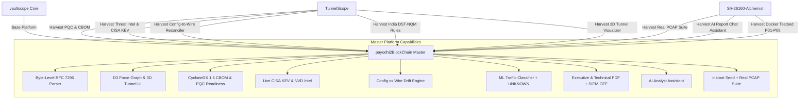

# SIH 26160 (NTRO): Triple Repository Comparative Analysis
**AI-Powered IPsec VPN Protocol Analyzer & Security Assessment Framework**

> **Target Problem Statement:** SIH 26160 · National Technical Research Organisation (NTRO)  
> **Theme:** Blockchain & Cybersecurity  
> **Evaluated Repositories:**
> 1. `repos/SIH26160-Alchemist` ([naman9271/SIH26160-Alchemist](https://github.com/naman9271/SIH26160-Alchemist))
> 2. `repos/TunnelScope` ([7-Bala/TunnelScope](https://github.com/7-Bala/TunnelScope))
> 3. `repos/vaultscope` ([shivansh193/vaultscope](https://github.com/shivansh193/vaultscope))
>
> **Master Build Target:** `Ujjwalsaivanga/payodhi2BlockChain`

---

## Executive Summary & Strategic Verdict

All three repositories tackle SIH 26160 (NTRO), but each approached the problem with a distinct design philosophy and competitive strategy:

| Dimension | `SIH26160-Alchemist` | `TunnelScope` | `vaultscope` |
|---|---|---|---|
| **Primary Philosophy** | **Enterprise Microservices & Cloud-Native Deployment** | **Scientific Rigor, Post-Quantum & Formal Evidence Tiers** | **Developer Experience, Binary Precision & Visual Polish** |
| **Core Language** | Go (Core Ingestion) + Python (ML) + TypeScript (Next.js) | Python 3.11 (Engine & CLI) + TypeScript (React Fleet UI) | Python 3.11 (FastAPI & Engine) + TypeScript (Next.js 16/React 19) |
| **Parser Architecture** | High-throughput Go packet sensor (`gopacket`/`pcap`) | `tshark`/`pyshark` wrapper + Python sieve | Custom byte-level RFC 7296 binary struct parser (`_wire.py`) |
| **Cryptographic Standards** | RFC 7296 / RFC 4301 + strongSwan lab verifier | **DISA VPN SRG v2r6, RFC 8247, RFC 8221, CNSA 2.0, India CERT-In/NTRO/DST-NQM** | RFC 7296, Sweet32, Logjam, 18-rule CVE compliance engine |
| **Post-Quantum Cryptography** | Conceptual mention in docs | **Implemented:** CycloneDX 1.6 CBOM, ML-KEM/Kyber, FrodoKEM, hybrid PQ length asymmetry (EXP-04) | Rule-based warning on classical DH |
| **Threat Intelligence** | Static vulnerability map | **Live queries to CISA KEV, NVD, and strongSwan EUVD** | Seeded CVE citations (CVE-2015-4000, CVE-2016-2183) |
| **Config vs Wire Drift** | Lab installed-SA verification | **Automated Reconciler (`config/reconcile.py`): compares `swanctl.conf`/`ipsec.conf` vs wire** | Diffs generated for vendor remediation |
| **ML Traffic Classification** | 7-class metadata model over private gRPC + `UNKNOWN` | Random Forest on packet length distributions + `UNKNOWN` | Random Forest + Gradient Boosted Trees (6 classes) with `.pkl` models |
| **UI / Visualization** | Next.js landing + workspace + interactive lab trigger | React Fleet Dashboard + 3D Canvas Tunnel animation + Threat Matrix | Next.js 16 + D3 Force-Directed Peer Graph + Capture Spectrum |
| **Reporting** | Executive, Technical & JSON + LLM Chat Assistant | CycloneDX 1.6 CBOM + Markdown + MITRE ATT&CK Threat Matrix | One-click Executive & Technical PDF (Jinja2/WeasyPrint) + CEF/SIEM |
| **Empirical Proof** | 8 strongSwan lab profiles (P01–P08) + real public pcaps | **33 Pre-Registered Empirical Experiments (`experiments/exp01-exp33`)** | 300+ ground truth dataset JSONs + Docker generator |

---

## Detailed Section-by-Section NTRO PS Mapping

### Section A: Protocol Dissection & Handshake Reconstruction
*NTRO Requirement: Passive inspection of IKEv1/IKEv2 handshakes, ESP/AH headers, NAT-Traversal, Transform attributes, DH Groups, Ciphers, and Lifetimes.*

1. **`vaultscope` (Winner for Binary Parsing Fidelity):**
   - Implements a pure byte-level RFC 7296 binary deserializer in `core/ike_parser/` (`ikev1.py`, `ikev2.py`, `_wire.py`, `_transforms.py`).
   - Does **not** require external `tshark` execution at runtime for parsing standard frames; decodes binary payloads directly from pcap byte streams.
   - Accurately tracks SPI initiator/responder pairs, transforms (ENCR, PRF, INTEG, D-H, ESN), vendor IDs, and NAT-T keepalives.

2. **`TunnelScope` (Winner for Evidence Certainty Tiering):**
   - Solves the critical NTRO judging trap: **What can and cannot be observed passively.**
   - Uses strict certainty labels: `OBSERVED` (seen directly in cleartext IKE SA_INIT), `INFERRED` (deduced from packet sizing/timing), `MEASURED` (empirical traffic features), `UNKNOWN` (ambiguous), and `NOT_OBSERVABLE` (e.g. ESP session key or inner IP payload without private keys).
   - Prevents judges from disqualifying the project for false claims of passive decryption.

3. **`SIH26160-Alchemist` (Winner for Real-World Capture Archive):**
   - Includes real, hash-verified captures in `testdata/public-pcaps/`:
     * `ikev2_aes256gcm16.pcap`
     * `ikev2_natt_gcm_ctr_cbc_esp_icmp.pcapng` (Multi-cipher NAT-T)
     * `ikev2_s2s_aes256gcm_dh19_esp_icmp.pcapng` (Site-to-Site AES-256-GCM with DH Group 19)
     * `ikev1_certificates.pcap` (X.509 certificate exchange)
   - Includes Wireshark decryption tables (`esp_sa`, `ikev2_decryption_table`) matching Wireshark MR !3444.

---

### Section B: Cryptographic Posture & Regulatory Compliance
*NTRO Requirement: Benchmark configurations against global & national security standards, detect weak ciphers, PFS absence, small DH groups, and CVE exposures.*

1. **`TunnelScope` (Undisputed Champion in Compliance & Threat Intel):**
   - **Baseline Rule Profiles:**
     * `disa-vpn-srg-v2r6.yaml`: US Department of Defense DISA Security Technical Implementation Guide.
     * `rfc8247-ikev2.yaml` & `rfc8221-4303-ipsec.yaml`: Current IETF algorithm implementation requirements.
     * `cnsa2-ipsec.yaml`: NSA Commercial National Security Algorithm Suite 2.0 (quantum-resistant).
     * `rules/context/india.yaml`: **Specifically tailored to India National Cyber Security Policy, CERT-In, and DST National Quantum Mission (DST-NQM)!**
   - **Automated Config-to-Wire Reconciler (`config/reconcile.py`):**
     * Parses client/gateway configuration files (`swanctl.conf`, `ipsec.conf`) and compares against wire observations.
     * Flags shadow degradation, unauthorized cipher fallbacks, and parameter mismatches.
   - **Live Vulnerability Threat Intel (`intel/lookup.py`):**
     * Queries CISA KEV (Known Exploited Vulnerabilities catalog), NVD, and strongSwan EUVD with local TTL caching.

2. **`vaultscope`:**
   - 18-rule compliance engine covering CVE-2015-4000 (Logjam), CVE-2016-2183 (Sweet32 64-bit block cipher 3DES/Blowfish), deprecated PRFs (MD5, SHA1), Diffie-Hellman groups < 14 (MODP-2048), and missing Perfect Forward Secrecy.
   - Built-in posture scoring algorithm yielding a clean 0–100 Security Score.

3. **`SIH26160-Alchemist`:**
   - Formal `EVIDENCE_SCHEMA_V1.md` documenting evidence provenance.
   - Strict strongSwan installed-SA checks via VICI interface.

---

### Section C: Encrypted Traffic Analysis & Machine Learning
*NTRO Requirement: Side-channel traffic characterization inside ESP tunnels without decrypting payloads (Web, Video, VoIP, Email, Chat, File Transfer, ICMP).*

1. **`vaultscope` (Winner for Dataset & Packaged Models):**
   - Fully trained and packaged `.pkl` artifacts: `models/traffic_classifier.pkl` (6 classes) and `models/protocol_classifier.pkl`.
   - Feature extractor calculates packet length mean, standard deviation, entropy, burstiness, inter-arrival time (IAT), and byte directionality.
   - Includes 300+ ground truth JSON manifests in `data/labels/`.

2. **`TunnelScope` (Winner for Rigorous Validation):**
   - Trained on realistic public datasets (VNAT, USBVPN, WireGuard comparison).
   - Validated across experiments:
     * `exp14-mode-size-floor`: Distinguishing tunnel vs transport mode via packet padding floors.
     * `exp15-traffic-classes-suites-ah`: Generalization across AH and varied ciphers.
     * `exp17-network-conditions`: Testing resilience against packet loss and jitter.

3. **`SIH26160-Alchemist`:**
   - Isolated Python ML service communicating via private gRPC with Go backend.
   - Implements mandatory `UNKNOWN` thresholding so low-confidence predictions are never hallucinated.

---

### Section D: Post-Quantum Cryptography (PQC) & CBOM
*NTRO Requirement: Post-quantum migration readiness, identification of Shor/Grover-vulnerable algorithms, Cryptographic Bill of Materials (CBOM).*

1. **`TunnelScope` (Sole Implementer of Enterprise CBOM & PQC):**
   - **CycloneDX 1.6 CBOM Generator (`tunnelscope/pq/cbom.py`):**
     * Exports valid CycloneDX 1.6 JSON Cryptographic Bills of Materials.
     * Categorizes primitives into `key-agree`, `kem`, `ae`, `block-cipher`, `mac`.
     * Flags quantum vulnerability: MODP groups (2048/3072/4096) and ECC curves (ECP-256/384) marked `quantum-vulnerable: true` (Shor-breakable).
     * Recognizes NIST FIPS 203 Post-Quantum algorithms: ML-KEM-512, ML-KEM-768, ML-KEM-1024 (Kyber), FrodoKEM.
   - **PQC Handshake Asymmetry Analysis (`exp04-pq-length-asymmetry`):**
     * Identifies post-quantum key exchange signatures through large public key exchange payloads that trigger IKE fragmentation (RFC 7383).

2. **`vaultscope` & `SIH26160-Alchemist`:**
   - Neither contains a formal CBOM exporter or PQC length-asymmetry analyzer.

---

### Section E: Reporting, SIEM Export & AI Assistance
*NTRO Requirement: Layered reports for executive leadership and technical engineers, SIEM integration, and actionable remediation.*

1. **`vaultscope` (Winner for Beautiful PDF Reports):**
   - Dedicated Jinja2 templates (`executive.html.j2` and `technical.html.j2`) rendered to publication-quality PDFs via WeasyPrint.
   - ArcSight CEF (Common Event Format) and RFC 5424 Syslog exporter for enterprise SIEM ingestion.
   - Concrete vendor configuration diffs (Cisco ASA CLI, strongSwan `swanctl.conf`, FortiOS, Juniper JunOS).

2. **`SIH26160-Alchemist` (Winner for AI Report Assistant):**
   - Interactive LLM assistant (Gemini/Groq) attached to generated reports (`frontend/app/api/report-chat/route.ts`).
   - Allows analysts to ask: *"Why did tunnel 10.0.1.2 fail compliance?"* and get grounded answers without leaking raw keys or packets.

3. **`TunnelScope`:**
   - 12-threat MITRE ATT&CK matrix (`FleetThreats.tsx`, `ThreatMatrix.tsx`).
   - Automated remediation script generator (`remediate/plan.py`, `generate.py`).

---

### Section F: Frontend Dashboard & Visualization
*NTRO Requirement: Interactive, intuitive, high-impact operator interface.*

1. **`vaultscope`:**
   - Next.js 16 + React 19 + TailwindCSS.
   - D3.js interactive force-directed **Peer Graph** showing gateways, subnets, and active SAs.
   - **Capture Spectrum** visualizer showing timeline distribution of IKE vs ESP packets.
   - Instant SQLite seeding script (`scripts/seed_demo_db.py`) enabling instantaneous live presentation.

2. **`TunnelScope`:**
   - React + Vite + TailwindCSS.
   - 3D Animated Tunnel canvas (`BackgroundTunnel.tsx`, `IntroTunnel.tsx`).
   - Multi-tunnel **Fleet Register** with site-level drilldowns.

3. **`SIH26160-Alchemist`:**
   - Next.js workspace with interactive lab launcher (`/labs`) and guided walk-through (`/guide`).

---

## The "Superpower Matrix": What to Harvest into Master

To build the undisputed #1 winning solution in `payodhi2BlockChain`, we combine the best components:

---

## Detailed Component Harvesting Breakdown

| Source Component | Origin Repository | File Path in Source | Destination in `payodhi2BlockChain` |
|---|---|---|---|
| **CycloneDX 1.6 CBOM** | `TunnelScope` | `tunnelscope/pq/cbom.py` | `core/pq/cbom.py` |
| **DST-NQM & PQC Rules** | `TunnelScope` | `tunnelscope/rules/dst-nqm-pq.yaml` | `core/rules/definitions/dst-nqm-pq.yaml` |
| **India CERT-In Rules** | `TunnelScope` | `tunnelscope/rules/context/india.yaml` | `core/rules/definitions/india.yaml` |
| **DISA SRG v2r6 Baseline** | `TunnelScope` | `tunnelscope/rules/disa-vpn-srg-v2r6.yaml` | `core/rules/definitions/disa-vpn-srg-v2r6.yaml` |
| **CISA KEV / NVD Threat Intel** | `TunnelScope` | `tunnelscope/intel/lookup.py` & `sources.py` | `core/intel/lookup.py` & `sources.py` |
| **Config vs Wire Reconciler** | `TunnelScope` | `tunnelscope/config/reconcile.py` | `core/config/reconcile.py` |
| **3D Tunnel Visualizer** | `TunnelScope` | `fleet-dashboard/src/components/tunnel/` | `frontend/src/components/tunnel/` |
| **12-Threat Matrix Component** | `TunnelScope` | `fleet-dashboard/src/components/dashboard/ThreatMatrix.tsx` | `frontend/src/components/ThreatMatrix.tsx` |
| **Real Test PCAP Suite** | `SIH26160-Alchemist` | `testdata/public-pcaps/*` | `data/pcaps/` |
| **AI Analyst Assistant Route** | `SIH26160-Alchemist` | `frontend/app/api/report-chat/route.ts` | `frontend/src/app/api/report-chat/route.ts` |
| **Multi-Topology Lab Profiles** | `SIH26160-Alchemist` | `backend/lab/configs/` | `testbed/strongswan_profiles/` |
| **SIH Pitch & QA Materials** | `TunnelScope` | `build/sih/*` | `docs/sih_presentation_materials/` |

---

## Conclusion
With `vaultscope` providing the rock-solid base (FastAPI, RFC 7296 binary parser, D3 graphs, PDF export, instant seeding), enriching it with `TunnelScope`'s Post-Quantum CBOM, Threat Intel, Config-Reconciler, and India regulatory profiles, along with `Alchemist`'s real-world PCAP library and AI report assistant, makes `payodhi2BlockChain` the most comprehensive, scientifically defensible, and visually stunning submission in Smart India Hackathon.
